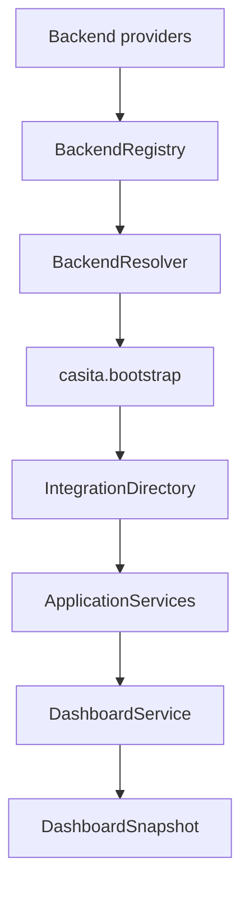

# Nuestra Casita Composition Root

## Purpose

`casita.bootstrap` is the single construction boundary for the Nuestra Casita
application. It connects concrete integration instances to backend-neutral
application services and owns the resulting object graph.

The composition root contains dependency wiring only. It does not read
household data, apply business rules, synchronize catalogs, or assemble
dashboard sections.

## Dependency Graph



Concrete adapters depend on the integration and domain contracts. The
composition root may import concrete adapters when they exist. Application
services never import or branch on an adapter implementation.

## Constructed Application

`build_application()` creates and returns a `NuestraCasitaApplication`
containing:

- One `IntegrationDirectory`
- One instance of every household capability service
- One `DashboardService`
- One `CatalogApplicationService`
- One `SynchronizationApplicationService`
- One integration-backed `CatalogPlanner` and `CatalogExecutor`
- One `DoctorService`
- One `MaintenanceService` for backward-compatible commands
- Validated `ApplicationConfiguration`

`ApplicationServices` groups the Shopping, Inventory, Recipe, Chore,
Calendar, Budget, Notification, Device, and Media services. The dashboard
service receives those same instances rather than constructing duplicates.

`build_grocy_application()` constructs one `GrocyApiClient`, injects it into
the Grocy adapter, and registers a `GrocyBackendProvider`. `BackendResolver`
selects Grocy as the default provider without exposing that choice to any
application service. The provider supplies its integrations, capability
ownership, catalog planner, and catalog executor. Concrete resource
registries, configuration loading, and native synchronization callbacks
remain confined to this composition boundary.

When optional Home Assistant credentials are complete, the same composition
root constructs one `HomeAssistantApiClient` and `HomeAssistantReadAdapter`,
registers it alongside Grocy, and assigns only `Capability.DEVICES` to it.
This is an additional integration, not a replacement synchronization backend;
Grocy remains the selected backend provider and its planner/executor are
unchanged. With no Home Assistant configuration, no adapter is registered.

## Object Lifetime

The object graph has application scope:

1. The process entry point creates configured integration instances.
2. It calls `build_application()` once.
3. The application retains the integration directory and services for the
   process lifetime.
4. Individual dashboard snapshots and service results remain short-lived,
   immutable values.
5. Process shutdown releases the graph.

The backend registry is application-scoped and explicitly populated during
startup. No global mutable registry, service locator, automatic package
discovery, or hidden singleton is used.

## Integration Registration

Backend registration and selection are explicit:

```python
registry = BackendRegistry()
registry.register(grocy_provider)
backend = BackendResolver(registry, default_key="grocy").resolve()
```

`build_grocy_application()` performs this production registration for Grocy
while `build_application()` and every application service remain
backend-neutral. A future backend can be selected by registering another
provider and resolving its key; application services do not change.

Each adapter declares capabilities through its `IntegrationDescriptor`.
Without ownership configuration, all adapters declaring a capability
contribute in registration order. An ownership mapping can select and order
specific providers for a capability.

Adding PantryParty, a test backend, or another replacement provider will
require:

1. Implementing the existing integration contracts.
2. Implementing `BackendProvider` for construction and ownership.
3. Registering the provider at startup.
4. Selecting it explicitly or making its key the default.

No application service or dashboard assembly branch should be added.

## Startup Flow

A future executable process will:

1. Load and validate deployment configuration.
2. Construct and register enabled backend providers.
3. Resolve the active provider and build its application graph.
4. Pass the returned application to a transport such as a future REST API.
5. Resolve a household and invoke application services.

Configuration loading, secrets, authentication, persistence, network
transport, and process shutdown hooks are intentionally outside this
milestone.
